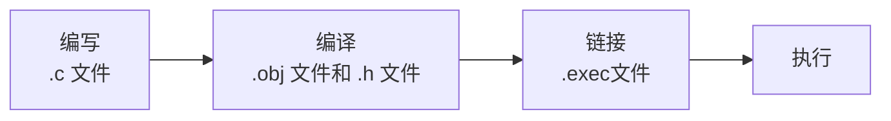

# 代码执行流程



*编译过程中除了编译的 .c 文件，还有使用到的头文件等。*

# 编译规则

## 找不到 `.obj` 文件

取决于使用的**编译命令**。在 GCC 编译器中，有两种常见的编译方式：

### 一步到位

```bash
gcc main.c -o main.exe
```

当你使用这种命令时，GCC 会在内存中自动完成“编译、汇编、链接”的所有步骤，**直接**生成 `.exe` 文件。为了保持目录整洁，它**不会**把中间的 `.obj`（或 `.o`）文件保存在硬盘上。

### 分步执行

如果使用 `-c` 参数，GCC 就会只执行到“编译和汇编”阶段，并把 `.obj` 文件生成在硬盘上。

```bash
# 第一步：只编译，生成 main.obj (或 main.o)
gcc -c main.c -o main.obj

# 第二步：链接，生成 main.exe
gcc main.obj -o main.exe
```

## 项目情况

1. 如果是用 VS Code 右上角的按钮 / Code Runner 运行的：
   之前配置的 Code Runner 命令是 `gcc $fullFileName -o ...exe`。正如上面所说，这是一步到位的命令，所以不会生成 `.obj` 文件。

2. 如果是用 `make run` 运行的：
   `Makefile` 中其实**包含**了生成 `.obj` 文件的规则！

   ```makefile
   .c.o:
       $(CC) $(CFLAGS) $(INCLUDES) -c -MMD $<  -o $@
   ```

   这个规则使用了 `-c` 参数，意味着它会生成 `.obj` 文件。
   但是 `Makefile` 里定义了清理规则：

   ```makefile
   clean:
       $(RM) $(call FIXPATH,$(OBJECTS))
   ```

   通常，`make run` 执行完后，或者在执行 `make clean` 时，这些中间的 `.obj` 文件就会被自动删除，以节省磁盘空间。

## 验证

如果想看到 `.obj` 文件的生成过程，可以打开 VS Code 的终端，手动输入以下命令。

```bash
cd src
gcc -c main.c -o main.obj
```

执行完后，会立刻在 `src` 目录下看到一个 `main.obj` 文件。接着可以输入 `gcc main.obj -o test.exe` 来把它链接成可执行文件。

# 注释

## 介绍

在程序指定位置添加的说明性信息，增加代码的阅读性。

注释不会被翻译成指令。

## 分类

### 单行注释

```c
// 注释
```

### 多行注释

```c
/*
注释
*/
```

# 关键字

被 C 语言赋予了特定含义的单词。

# 常量

| 常量类型   | 说明                                         | 示例1                            | 示例2  |
| ---------- | -------------------------------------------- | -------------------------------- | ------ |
| 整型常量   | 正数、负数、0                                | `18`                             | `19`   |
| 实型常量   | 所有带小数点的数字                           | `1.93`                           | `18.2` |
| 字符常量   | 单引号引起的**字母**、**数字**、**英文符号** | `'A'`                            | `'C'`  |
| 字符串常量 | 双引号引起来                                 | `"尼古拉斯·纯情·暖男·天真·何止"` | —      |

- 实型常量如果小数点前或者后都是 0，则可以省略不写。
- 实型常量也可以用科学计数法：`1.234000000E7`。

# 输出

`printf` 是 C 语言中非常核心的标准库函数，主要用于将格式化的字符串及对应的数据输出到标准输出设备（通常是显示器）。

## 函数使用格式

```c
int printf(
    const char *format,   // 格式控制字符串，包含普通字符和格式说明符
    ...                   // 可变参数列表，包含要输出的数据项，数量和类型需与格式说明符一一对应
);
```

## 参数详细说明

| 参数名称 | 作用说明       | 可选值 / 详细说明                                            |
| -------- | -------------- | ------------------------------------------------------------ |
| `format` | 格式控制字符串 | 由普通字符（原样输出）、转义字符（如 `\n` 换行）和格式说明符（以 `%` 开头）组成。 |
| `...`    | 输出参数列表   | 可以是常量、变量或表达式。参数的个数和类型必须与 `format` 中的格式说明符严格对应。 |

## 格式说明符

完整的格式说明符结构为：`%[标志][最小宽度][.精度][类型长度]转换说明符`。

| 结构位置                | 作用说明                       | 可选值 / 详细说明                                            |
| ----------------------- | ------------------------------ | ------------------------------------------------------------ |
| 标志（flags）           | 控制输出的对齐、符号及填充样式 | `-`（左对齐）、<br />`+`（正数显示加号）、<br />`0`（左侧补零）、<br />空格（正数前加空格）、<br />`#`（显示八进制或十六进制前缀）。 |
| 最小宽度（width）       | 规定输出数据的最小字符宽度     | 十进制整数。<br />若实际数据长度不足，默认右侧补空格；<br />若指定了 `0` 标志，则左侧补零。 |
| 精度（.precision）      | 控制数据的精确度               | 由点号 `.` 和整数组成。<br />对浮点数表示小数位数；<br />对字符串表示最大输出字符数；<br />对整数表示最少输出位数。 |
| 类型长度（length）      | 修饰参数的数据类型长度         | `h`（短整型）、<br />`l`（长整型或宽字符）、<br />`ll`（长长整型）、<br />`L`（长双精度浮点数）等。 |
| 转换说明符（specifier） | 规定输出数据的类型和进制       | `d` 或 `i`（十进制整数）、<br />`u`（无符号十进制整数）、<br />`f`（浮点数）、<br />`c`（字符）、<br />`s`（字符串）、<br />`x` 或 `X`（十六进制）、<br />`o`（八进制）、<br />`p`（指针地址）、<br />`%`（输出百分号本身）。 |

## 换行

- `\r`：回到行首。
- `\n`：换行。

## 简单代码示例

```c
#include <stdio.h>

int main() {
    int age = 18;
    float score = 95.6789;
    char name[] = "Alice";

    // 基础输出与换行符
    printf("Hello, %s!\n", name); 

    // 使用标志和最小宽度：左对齐，总宽度占 10 个字符
    printf("Age: %-10d|\n", age); 

    // 使用精度控制：保留 2 位小数
    printf("Score: %.2f\n", score); 

    // 组合使用：补零、最小宽度为 8、保留 2 位小数
    printf("Format: %08.2f\n", score); 

    return 0;
}
```

# 输入

`scanf` 是 C 语言标准库中用于格式化输入的核心函数，它的主要作用是从标准输入流（通常是键盘）读取字符序列，并按照指定的格式将其解析为不同类型的数据，最后存储到程序变量的内存地址中。在使用时，开发者需要在格式控制字符串中定义好期望读取的数据类型和规则，并传入对应变量的内存地址，该函数通常在需要与用户进行交互式数据获取，或者从标准输入流中按特定规则批量读取数据时使用。

## 函数使用格式

```c
int scanf(const char *format, ...); // format：格式控制字符串，指定输入数据的解析规则；...：可变参数列表，必须传入接收数据的变量地址（字符数组名除外），数量与类型需与格式说明符严格对应
```

## 参数详细说明

| 参数名称 | 作用说明               | 可选值 / 类型                                        | 示例                           |
| -------- | ---------------------- | ---------------------------------------------------- | ------------------------------ |
| `format` | 格式控制字符串         | 包含格式说明符、空白字符、非空白字符的字符串         | `"%d %f"`、<br />`"a=%d,b=%c"` |
| `...`    | 接收数据的变量地址列表 | 指向变量的指针（除字符数组名外均需使用取地址符 `&`） | `&a`、`&b`、`str`              |

## 格式控制字符串

完整的格式说明符结构为：`%[*][宽度][长度]转换说明符`。

| 结构位置             | 作用说明                         | 可选值 / 类型                                                | 示例                                                         |
| -------------------- | -------------------------------- | ------------------------------------------------------------ | ------------------------------------------------------------ |
| 赋值忽略符（`*`）    | 读取对应数据但不赋值给任何变量   | `*`（读取并丢弃）                                            | `%*d`（读取一个整数但不存储）                                |
| 域宽（width）        | 限制该格式说明符最多读取的字符数 | 非零十进制正整数                                             | `%9s`（最多读取 9 个字符，防止缓冲区溢出）                   |
| 长度修饰符（length） | 修正接收参数的底层数据类型长度   | `h`（短整型）、<br />`l`（长整型或双精度浮点型）、<br />`ll`（长长整型） | `%lf`（读取 `double` 类型）、<br />`%hd`（读取 `short` 类型） |
| 转换说明符（type）   | 规定输入数据的类型和解析方式     | `d`（十进制整数）、<br />`f`（单精度浮点数）、<br />`c`（单字符）、<br />`s`（字符串）、<br />`x`（十六进制整数）、<br />`o`（八进制整数）、<br />`p`（指针地址） | `%d`、`%lf`、`%s`、`%c`                                      |

## 简单代码示例

```c
#include <stdio.h>

int main() {
    int age;
    float score;
    char name[20];

    // 基础用法：按顺序读取整数、浮点数和字符串，变量前需加取地址符（数组名除外）
    scanf("%d %f %19s", &age, &score, name); 

    // 格式化匹配：如果格式串中包含非空白字符（如逗号），输入时也必须严格输入该字符
    scanf("age=%d,score=%f", &age, &score); 

    // 赋值忽略：读取三个整数，但只保留第一个和第三个，丢弃第二个
    scanf("%d %*d %d", &age, &score); 

    return 0;
}
```

# 占位符

## 格式化模板

在 C 语言中，所有带 `%` 的格式化占位符都遵循一个**万能公式**。

```text
% [标志] [最小宽度] [.精度] [类型修饰符] 转换字符
```

> 注：除了 `%` 和最后的“转换字符”是必填的，中间的所有部分都是可选的。

## 模板各位置功能详解

| 模板位置          | 填写内容                    | 核心功能说明                                                 |
| ----------------- | --------------------------- | ------------------------------------------------------------ |
| **1. 标志**       | `-` `+` `0` `空格` `#`      | **控制对齐与特殊符号** <br />• `-`：左对齐（默认是右对齐） <br />• `+`：强制显示正负号（正数前加 `+`） <br />• `0`：宽度不够时，左侧补 `0` 而不是补空格 <br />• `#`：带前缀输出（八进制加 `0`，十六进制加 `0x`） |
| **2. 最小宽度**   | 数字（如 `5`，`10`）        | **控制排版宽度** 规定输出的最少字符数。<br />如果实际数据长度小于该值，多余的空间会用空格（或 `0`）填充。 |
| **3. 精度**       | `.` + 数字（如 `.2`，`.4`） | **控制数据精度或截断** <br />• 对浮点数：规定小数点后的位数（四舍五入） <br />• 对字符串：规定最多输出的字符个数（截断） <br />• 对整数：规定最少输出的位数（不足补零） |
| **4. 类型修饰符** | `h`，`l`，`ll` 等           | **修正底层数据类型** 告诉编译器实际传入的变量类型。 <br />• `l`：用于长整型 `ld` 或宽字符 `lc` <br />• `ll`：用于超长整型 `lld` |
| **5. 转换字符**   | `d`，`f`，`s`，`c`，`x` 等  | **决定数据类型与进制** <br />• `d/i`：十进制整数 <br />• `f`：浮点数 <br />• `s`：字符串 <br />• `c`：字符 <br />• `x/X`：十六进制 <br />• `p`：内存指针地址 |

## 模板组合实战演示

1. **`%08.2f`** 

   - 拆解

     `0` （补零） + `8`（总宽度8） + `.2`（保留2位小数） + `f`（浮点数）

   - 效果

     如果输入 `3.14`，输出为 `00003.14`（总长度8，左侧补了3个零）。

2. **`%-10s`**

   - 拆解

     `-`（左对齐） + `10`（总宽度10） + `s`（字符串）

   - 效果

     如果输入 `"Hi"`，输出为 `"Hi        "`（总长度10，右侧补了8个空格）。

3. **`%+d`**

   - 拆解

     `+`（显示符号） + `d`（整数）

   - 效果

     如果输入 `42`，输出为 `+42`；如果输入 `-42`，输出为 `-42`。

4. **`%#x`**

   - 拆解

     `#`（加前缀） + `x`（十六进制）

   - 效果

     如果输入 `255`，输出为 `0xff`（自动加上了 `0x` 前缀）。

# 变量

## 介绍

可以理解为存储数据的盒子，是经常发生改变的数据。

## 变量定义格式

`数据类型 变量名;` 

## 变量的使用

`变量 = 值;` 

## 注意事项

1. 一个变量只能存一个值

2. 变量名不允许重复定义

3. 一条语句可以定义多个变量

   ```c
   int b = 10, c = 20, d = 30;
   ```

4. 变量使用之前一定要进行赋值

5. 变量的作用范围

# 计算机的存储规则

在计算机中，任意数据都是以二进制的形式来存储的。

# 数据类型

## 作用

1. 决定存储数据的类型。
2. 决定存储数据的大小。

| 换算关系 | 等式                             |
| :------- | :------------------------------- |
| 字节与KB | $1024 \text{字节} = 1 \text{KB}$ |
| KB与MB   | $1024 \text{KB} = 1 \text{MB}$   |
| MB与GB   | $1024 \text{MB} = 1 \text{GB}$   |
| GB与TB   | $1024 \text{GB} = 1 \text{TB}$   |
| TB与PB   | $1024 \text{TB} = 1 \text{PB}$   |
| PB与EB   | $1024 \text{PB} = 1 \text{EB}$   |
| EB与ZB   | $1024 \text{EB} = 1 \text{ZB}$   |
| ZB与YB   | $1024 \text{ZB} = 1 \text{YB}$   |

## 分类总览

C 语言的数据类型主要分为以下四大类：

1. 基本类型

   包括整数类型、字符类型、浮点类型、布尔类型等。

2. 构造类型（聚合类型）

   包括数组、结构体（struct）、共用体（union）、枚举（enum）。

3. 指针类型

   用于存储变量的内存地址。

4. 空类型（void）

   表示无类型，常用于函数返回值或通用指针（void*）。

## 基本数据类型

### 整数类型

用于存储整数（Integer Types），根据占用内存大小和是否有符号进行划分。

| 类型关键字  | 常见存储大小 | 值范围（以常见 4 字节为例） | 备注                                                    |
| ----------- | ------------ | --------------------------- | ------------------------------------------------------- |
| `char`      | 1 字节       | -128 到 127                 | 本质是小整数，常用于存字符。                            |
| `short`     | 2 字节       | -32,768 到 32,767           | 短整型。                                                |
| `int`       | 4 字节       | -21亿 到 21亿               | 最常用的整数类型。                                      |
| `long`      | 4 或 8 字节  | 取决于操作系统              | 32位系统为4字节，64位Linux为8字节。<br />数字后加 `L`。 |
| `long long` | 8 字节       | -9.2×10¹⁸ 到 9.2×10¹⁸       | 用于存储超大整数。C99 才有。<br />数字后加 `LL`。       |

char 是整型数据中比较特殊的一种，其他如 short/int/long 等都默认是带符号整数，但 char 默认是无符号整数。无符号整数（unsigned short/int/long）的全部二进制位均为数值位，没有符号位，相当于数的绝对值。

> 实际定义 `short` 或者 `long` 等，其实完整的写法是 `short int` 这样，表示短整形，只不过 `int` 一般省略了。
>
> `int` 后面不能再加 `int` 了。

### 符号修饰符

1. `signed`（有符号）

   默认情况，最高位作为符号位（0为正，1为负）。

2. `unsigned`（无符号）

   所有位都用于表示数值，不能存负数，但正数上限翻倍。

示例：`unsigned int` 的范围是 0 到 4,294,967,295。

`signed/unsigned` 整型数据都是按补码形式存储的，在不溢出条件下的加减运算也是相同的，只是 signed 型的最高位代表符号位，而在 unsigned 型中表示数值位，而这两者体现在输出上则分别是 `%d` 和 `%u`。

```c
#include <stdio.h>

int main() {
    unsigned char a = -1;

    printf("%c", a); // 255
    /**
     * 无符号整数。符号本质是人为规定的，计算机底层存储的只有二进制代码。
     * 如果我说 -1 是无符号小整数，首先，-1 在底层的存储，采用补码，
     * 机器字长为 4，拿对应的映射正数为 2^8 - 1 = 255，
     * 存储的二进制代码为 1111 1111。
     * 我说它是无符号，好，计算机就把它当作无符号的整数，即二进制
     * 1111 1111 全部作为数值所表示的数，即 255。
     */

    return 0;
}
```

### 浮点类型

用于存储带小数点的实数（Floating-Point Types），遵循 IEEE 754 标准。

| 类型关键字    | 存储大小     | 精度                | 适用场景                                       |
| ------------- | ------------ | ------------------- | ---------------------------------------------- |
| `float`       | 4 字节       | 约 6-7 位有效数字   | 对精度要求不高的科学计算。<br />数字后加 `F`。 |
| `double`      | 8 字节       | 约 15-16 位有效数字 | 默认浮点类型，高精度计算。                     |
| `long double` | 8/12/16 字节 | 更高精度            | 极高精度需求（平台相关）。<br />数字后加 `L`。 |

> 打印 double 小数，占位符是 `"%lf"`，因为它是 8 位的，更长。

### 字符与布尔类型

1. `char`

   占用 1 字节，存储单个字符（如 `'A'`）或 ASCII 码值。

2. `_Bool`（C99 引入）

   布尔类型，占用 1 字节，值仅为 0（假）或 1（真）。通常包含 `<stdbool.h>` 后使用 `bool`、`true`、`false`。

## sizeof 运算符

1. 作用

   获取数据类型或变量在内存中占用的字节数。

2. 语法

   `sizeof(类型)` 或 `sizeof 变量`。

3. 示例

   `printf("%lu", sizeof(int));` 会输出当前平台 int 的字节数（通常为 4）。

## 内存存储机制

### 整数的存储

计算机内部不存储原码，而是存储补码。

1. 正数：原码、反码、补码相同。
2. 负数：补码 = 反码 + 1。

统一了加减法运算，且 0 只有一种表示形式。

### 浮点数的存储

采用 IEEE 754 标准。

浮点数在内存中分为三部分：符号位（S）、指数位（E）、尾数位（M）。

浮点数存在精度丢失问题，不能直接用 `==` 比较两个浮点数是否相等。

### 大小端模式

Endianness。

1. 小端模式（Little-endian）

   数据的低位字节存放在内存的低地址处（x86 架构常见）。

2. 大端模式（Big-endian）

   数据的高位字节存放在内存的低地址处（网络传输常用）。

## 类型转换规则

1. 隐式转换

   当不同类型混合运算时，C 语言会自动将低精度类型转换为高精度类型（如 `int` 与 `double` 运算，`int` 会转为 `double`）。

2. 显式转换（强制类型转换）

   语法为 `(目标类型)表达式`，比如 `int a = (int)3.14;` 结果为 3（直接截断小数部分）。

   > 强制转换可能导致数据溢出或精度丢失，需谨慎使用。

# 运算符

## 常见

| 运算符分类     | 运算符                       |
| -------------- | ---------------------------- |
| 算术运算符     | `+` `-` `*` `/` `%`          |
| 自增自减运算符 | `++` `--`                    |
| 赋值运算符     | `=` `+=` `-=` `*=` `/=` `%=` |
| 关系运算符     | `==` `!=` `>` `>=` `<` `<=`  |
| 逻辑运算符     | `!` `&&` `||`                |
| 三元运算符     | `a > b ? a : b`              |

取余运算必须全部是整数。

> **自增/减运算**
>
> 1. 分为前缀和后缀。前缀先操作后用，后缀先用后操作。
>
> 2. 在 Windows 中，前缀优先级最高，后缀优先级最低。
>
>    比如 `a = 10`，`a++ + a++` 会先把原始数据拿出来相加，变量再自增。前缀则是全部增完后在进行相加。
>
> 3. 在 mac 或者 Linux 中，前缀后缀优先级一样，从左到右依次计算。
>
>    比如 `a = 10`，`a++ + a++`，从左到右，是 `10 + 11`。

## 逗号运算符

```c
表达式1, 表达式2, ... , 表达式n
(i = 3, i++, ++i, i+5)
```

1. 从左到右
2. 最后一个子表达式的结果，是整个表达式的结果
3. 优先级最低（永远是最后执行）

## 运算符优先级

| 运算符                            | 名称                                                        |
| --------------------------------- | ----------------------------------------------------------- |
| `()`                              | 小括号                                                      |
| `++`、`--`                        | 自增、自减 windows: 先++优于后++ mac、Linux从左到右依次计算 |
| `+`、`-`、`!`                     | 正号、负号、逻辑非                                          |
| `*`、`/`、`%`                     | 乘、除、取余                                                |
| `+`、`-`                          | 加、减                                                      |
| `>`、`>=`、`<`、`<=`              | 关系运算符                                                  |
| `==`、`!=`                        | 关系运算符                                                  |
| `&&`                              | 逻辑与                                                      |
| `||`                              | 逻辑或                                                      |
| `?:`                              | 三元运算符                                                  |
| `=`、`*=`、`/=`、`%=`、`+=`、`-=` | 赋值运算符                                                  |
| `,`                               | 逗号运算符                                                  |

- 小括号优先于所有
- 一元 > 二元 > 三元
- `&&` > `||` > 赋值

# 强制转换

`目标数据类型 变量名 = (目标数据类型) 被强转的数据;` 

# 流程控制语句

## 顺序结构

1. 顺序结构是程序默认的执行流程。
2. 顺序结构是从上往下依次运行的。

## 分支结构

程序在执行过程中出现了岔路。

### if 语句

```c
if (关系表达式A) {
    语句体A;
} else if (关系表达式B) {
    语句体B;
} else if (关系表达式C) {
    语句体C;
}
... else {
    语句体N;
}
```

### switch 语句

```c
switch(表达式) {
    case 值1:
        语句体1;
        break;
    case 值2:
        语句体2;
        break;
    ...
    default:
        语句体n;
        break;
}
```

**细节说明**

1. 表达式：计算结果只能为（字符/整数）
2. case：值只能是（字符/整数）的字面量，不能是变量
3. case：值不允许重复
4. break：表示中断，结束的意思，结束switch语句
5. default：所有情况都不匹配，执行该处的内容

## 循环结构

### for 循环

```c
for（初始化语句;条件判断语句;条件控制语句）{
    循环体语句;
}
```

### while 循环

```c
初始化语句;
while（条件判断语句）{
    语句体;
}
```

# `goto` 关键字

`goto` 是 C 语言中的无条件跳转语句，允许程序控制流直接转移到同一函数内由标签标记的指定位置。

## 语法格式与使用方式

```c
// 跳转语句：无条件跳转到指定标签
goto 标签名;  // 标签名是合法标识符，分号表示语句结束

// 标签定义：标签名后紧跟冒号，冒号后为跳转目标语句
标签名: 语句;  // 标签具有函数作用域，同一函数内不可重名
```

## 必须搭配的语法元素

1. 标签标识符

   由字母、数字、下划线组成，以字母或下划线开头，遵循 C 语言标识符命名规则。

2. 冒号 `:`

   用于分隔标签名与目标语句，不可省略。

3. 分号 `;`

   `goto` 语句本身以分号结尾。

4. 目标语句

   标签后必须紧跟一条可执行语句；若标签位于声明之前或代码块末尾，需使用空语句（即 `标签名:;`）占位。

`goto` 拥有独立的命名空间，标签名不会与变量名、函数名等其他标识符冲突。

## 语法成分详解

| 语法成分       | 作用                 | 数据类型/格式要求                                            | 可选写法/说明                                       |
| -------------- | -------------------- | ------------------------------------------------------------ | --------------------------------------------------- |
| `goto`         | 无条件跳转关键字     | 固定关键字，不可替换                                         | 无                                                  |
| 标签名         | 指定跳转目标位置     | 合法 C 标识符（字母、数字、下划线组成，<br />以字母或下划线开头） | 命名应语义清晰，<br />如 `cleanup`、`error_handler` |
| `;`（goto 后） | 结束跳转语句         | 固定标点                                                     | 无                                                  |
| `:`（标签后）  | 分隔标签与目标语句   | 固定标点，不可省略                                           | 无                                                  |
| 目标语句       | 跳转后继续执行的代码 | 任意合法 C 语句                                              | 若无实际语句需用空语句 `;` 占位                     |

## 使用限制与变体

| 限制/规则            | 说明                                                         |
| -------------------- | ------------------------------------------------------------ |
| 同一函数内跳转       | 标签必须与 `goto` 语句位于同一函数中，禁止跨函数跳转         |
| 禁止跳入 VLA 作用域  | C99 起，`goto` 不能跳入变长数组（VLA）或其他可变修改类型的作用域 |
| 禁止跳过变量初始化   | 向前跳转跳过带初始化的变量声明会导致未定义行为或编译错误     |
| 禁止跳入控制结构内部 | 不能跳入 `if`、`switch`、`for` 等语句内部                    |
| 标签不可重声明       | 同一函数内标签名唯一                                         |
| 向前跳转 vs 向后跳转 | 向前跳转（跳过代码）常用于错误处理；向后跳转（回到前面）可模拟循环，但不推荐 |

## 配套语法及行为影响

`goto` 常与以下控制语句搭配或作为其替代：

| 配套语法      | 与 `goto` 的关系         | 行为影响                                                     |
| ------------- | ------------------------ | ------------------------------------------------------------ |
| `break`       | `goto` 可替代 `break`    | `break` 仅跳出当前一层循环；`goto` 可一次性跳出多层嵌套循环  |
| `continue`    | `goto` 可替代 `continue` | `continue` 跳过本次循环进入下一轮；`goto` 可跳转到任意位置实现类似效果 |
| `return`      | `goto` 可辅助 `return`   | 在函数末尾设置统一清理标签，`goto` 跳转后执行资源释放再 `return`，避免重复代码 |
| `if` 条件判断 | `goto` 常与 `if` 配合    | `if (条件) goto 标签;` 实现条件跳转，是 `goto` 最常见的使用模式 |

| 替代方案            | 推荐场景             | 相比 `goto` 的优势   |
| ------------------- | -------------------- | -------------------- |
| `for`、`while` 循环 | 替代向后跳转模拟循环 | 结构清晰，可读性强   |
| `if-else` 分支      | 替代条件跳转         | 逻辑线性，易于维护   |
| 函数封装 + `return` | 替代跳出多层循环     | 模块化设计，职责分明 |

## 代码示例

```c
#include <stdio.h>
#include <stdlib.h>

int main(void) {
    // 示例1：跳出多层嵌套循环
    for (int i = 0; i < 5; i++) {
        for (int j = 0; j < 5; j++) {
            if (i == 2 && j == 2) {
                goto found;  // 直接跳出所有循环
            }
            printf("(%d, %d) ", i, j);
        }
    }
    found:
    printf("\n找到目标位置\n");

    // 示例2：统一错误处理与资源清理
    FILE *fp1 = NULL;
    FILE *fp2 = NULL;
    char *buf = NULL;

    fp1 = fopen("input.txt", "r");
    if (fp1 == NULL) goto cleanup;

    fp2 = fopen("output.txt", "w");
    if (fp2 == NULL) goto cleanup_fp1;

    buf = (char *)malloc(1024);
    if (buf == NULL) goto cleanup_fp2;

    // 正常处理逻辑...
    free(buf);
    cleanup_fp2:
    fclose(fp2);
    cleanup_fp1:
    fclose(fp1);
    cleanup:
    printf("资源清理完成\n");  // 统一出口

    return 0;
}
```

## 使用场景总结

1. 跳出多层嵌套循环

   当 `break` 只能跳出一层而需要一次性退出深层嵌套时，`goto` 比设置多个标志变量更简洁。

2. 统一错误处理与资源清理

   在函数中分配多个资源（文件、内存等）时，任一步骤失败可跳转到统一清理标签，按相反顺序释放已分配资源，避免代码重复。

3. 状态机切换

   在底层驱动或协议解析中，`goto` 可用于状态之间的快速跳转。

> 1968 年 Dijkstra 发表《Go To Statement Considered Harmful》指出 `goto` 会破坏程序结构、降低可读性，产生"意大利面条式代码"。 现代编程规范建议优先使用 `break`、`continue`、`return` 及函数封装等结构化控制流，仅在无更好替代方案时谨慎使用 `goto`。
