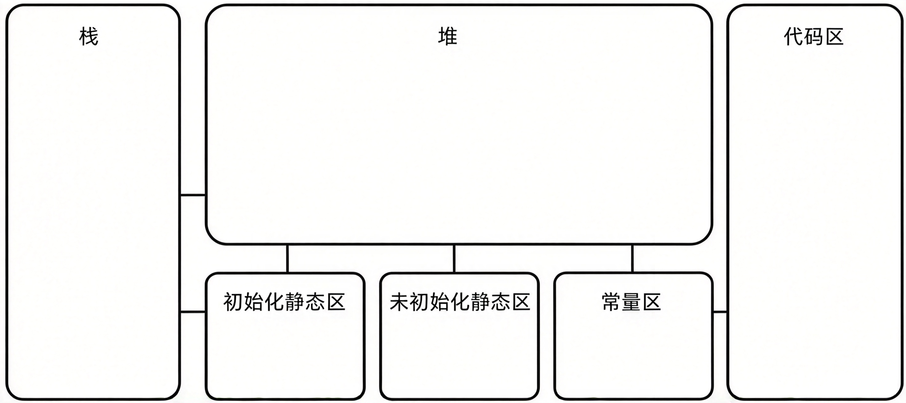

# 字符串

## 字符串的本质

C语言没有内置的字符串数据类型，字符串在底层本质上是以空字符 `\0`（ASCII码值为0）作为结束标志的字符数组或字符指针。这种以 `\0` 结尾的内存序列被称为空终止字符串（null-terminated string），所有标准库字符串处理函数均严格依赖此终止符来确定字符串的逻辑边界。

## 核心作用

1. 文本数据存储

   用于在内存中连续存储字母、数字、符号及标点等文本信息。

2. 用户交互与输入输出

   配合标准输入输出函数（如 `printf`、`scanf`、`fgets`），实现程序与用户的文本信息交互。

3. 数据处理与解析

   支持对文本数据进行查找、分割、拼接、比较等操作，广泛应用于配置文件解析、网络数据传输及日志处理等场景。

## 定义与初始化方式

### 字符数组初始化

使用字符串字面量初始化字符数组（如 `char str[] = "Hello";`），编译器会自动在末尾追加 `\0`，此时数组内容存储在栈区或数据段，允许后续修改。

```c
#include <stdio.h>

int main() {
    // 利用字符数组 + 双引号定义
    char str1[] = "abcd";
    printf("%s\n", str1);

    return 0;
}
```

在底层存储的时候，依然是把字符串拆成了多个字符进行存储，末尾还需要有 `'\0'` 作为结束标记。因此如果要写数组的长度，最少是写的字符串的长度 + 1，因为要为 `'\0'` 留出空间。

> 这种方式定义的字符串是可以改变的。
>
> ```c
> str1[0] = 'Q';
> printf("%s\n", str1); // Qbcd
> ```

### 字符指针初始化

使用字符指针指向字符串字面量（如 `char *ptr = "Hello";`），字符串常量存储在**只读**数据段，指针仅保存首地址，尝试修改该内存区域的内容会导致段错误（Segmentation Fault）。

```c
char *str2 = "abcd";
char *str3 = "abcd";
printf("%p\n", str2);
printf("%p\n", str3);
```

定义的字符串可以复用，也就是再创建相同的字符串时，就不会再创建新的，而是用原来的。

字符串底层依然是以数组的方式进行存储，结尾依然是 `'\0'`，此时定义的标识符是指向字符串的指针而不是数组。

> 是修改地址的内容会报错，不是修改地址。

### 逐字符赋值

手动为数组元素赋值时，必须显式在末尾添加 `\0`，否则该字符数组无法被识别为合法的字符串。

## 录入

```c
#include <stdio.h>
#include <string.h>

int main() {
    char s[100]; // 记得加上长度，初始化
    // char *s = NULL; 这样不行，因为是修改了

    printf("请输入一个字符串：");
    scanf("%s", s); // s 本身可以看作一个指针

    int length = strlen(s);

    for (int i = 0; i < length; i++) {
        printf("%c\n", s[i]);
    }

    printf("---------------------\n");

    int j = 0;
    while (s[j] != '\0') {
        printf("%c\n", s[j]);
        j++;
    }

    return 0;
}
```

## 赋值

```c
char s[100];
s = "abc";
```

在 C 语言中，数组名（如 `s`）属于**不可修改的左值（non-modifiable lvalue）**，不能出现在赋值运算符 `=` 的左侧。C 标准明确规定，可修改的左值不能是数组类型，因此 `s = "abc";` 会被编译器直接拒绝。

| 特性          | 数组名（`char s[100]`） | 指针变量（`char *p`）                 |
| ------------- | ----------------------- | ------------------------------------- |
| 本质          | 固定内存块的标签        | 存储地址的变量                        |
| 能否重新赋值  | 不能                    | 能                                    |
| `sizeof` 结果 | 返回整个数组的字节数    | 返回指针本身的大小（64位系统为8字节） |

如果要重新赋值，需要使用 `string.h` 头文件里的 `strcpy` 函数。

```c
char s[100];
strcpy(s, "abc");   // 将 "abc" 的内容拷贝到 s 指向的内存区域
```

或者使用指针变量。

```c
char *p = "abc";    // p 是指针变量，存储 "abc" 的地址
p = "xyz";          // 修改 p 存储的地址，让它指向 "xyz"

char *ptr = "Hello";   // 等价于：ptr = &"Hello"[0]，将首地址赋给指针变量
ptr = "World";          // 等价于：ptr = &"World"[0]，将新地址赋给指针变量
```

它是修改指针指向的内存地址，而不是修改内存地址里存储的值，因此不会出错。

## 标准库操作

C语言提供 `<string.h>` 头文件，包含一系列用于操作字符串的标准库函数：

1. 长度计算

   `strlen()` 函数通过遍历内存直到遇到 `\0` 来计算字符串的有效长度，返回值不包含 `\0`。

   *默认，中文占两个字节。*

2. 字符串复制

   `strcpy()` 函数将源字符串（包含 `\0`）完整复制到目标数组中，要求目标空间足够大且目标是可修改的；安全版本 `strncpy()` 可限制复制的字符数量。

3. 字符串拼接

   `strcat()` 函数将源字符串追加到目标字符串的末尾，要求目标空间足够大且目标是可修改的，覆盖目标字符串原有的 `\0`；安全版本 `strncat()` 可限制拼接的长度。

4. 字符串比较

   `strcmp()` 函数按字典序逐字符比较两个字符串，相等返回 `0`，大于返回正数，小于返回负数；严禁使用 `==` 运算符比较字符串内容（该运算符仅比较内存地址）。

5. 字符串查找

   `strstr()` 用于查找子串首次出现的位置，`strchr()` 和 `strrchr()` 分别用于查找字符首次和最后一次出现的位置。

6. 大小写转化

   - `strlwe` -> 变成小写
   - `strupr` -> 变成大写
   
   这两个已经废弃了，最好使用 `_strlwr` 和 `strupr`。

## 安全输入机制

1. 不安全输入

   `scanf("%s")` 遇到空格会停止读取，且不检查目标缓冲区边界，极易引发缓冲区溢出漏洞；`gets()` 函数因同样存在溢出风险已被 C11 标准废弃。

2. 安全输入

   推荐使用 `fgets(buffer, size, stdin)` 替代上述函数，该函数最多读取 `size - 1` 个字符并自动追加 `\0`，能有效防止越界，但需注意其会保留输入流中的换行符，后续处理时可能需要手动清除。

## 注意事项

1. 缓冲区溢出

   由于 `strcpy`、`strcat` 等基础函数不执行边界检查，若目标数组空间不足，写入操作会覆盖相邻内存区域，引发严重的安全漏洞或程序崩溃。

2. 内存管理

   使用字符指针处理动态字符串时，需通过 `malloc` 手动分配内存，并在使用完毕后调用 `free` 释放，以避免内存泄漏。

3. 循环性能陷阱

   在循环条件中应避免反复调用 `strlen()` 函数，因其时间复杂度为 O(N)，重复调用会导致整体时间复杂度退化为 O(N²)。

## 代码示例

### 数组遍历

```c
#include <stdio.h>

int main() {
    char arr[5][100] = {
        "Bob",
        "Andy",
        "Recursion",
        "John",
        "Fool",
    };

    for (int i = 0; i < 5; i++) {
        // 可以这么提取
        // char s[] = { arr[i] };
        // char *s = arr[i];

        printf("%s\n", arr[i]);
    }

    printf("------------------------------------\n");

    char *arr2[5] = {
        "Bob",
        "Andy",
        "Recursion",
        "John",
        "Fool",
    };

    for (int i = 0; i < 5; i++) {
        printf("%s\n", arr2[i]);
    }

    return 0;
}
```

# 结构体

## 介绍

结构体（`struct`）是C语言中一种由不同数据类型成员组成的复合数据类型（聚合数据类型），用于将逻辑上相关的数据封装为一个整体。结构体类型需使用 `struct` 关键字自定义，成员可包含基本类型、数组、指针或其他结构体，但不能为 `void`、不完整类型或函数类型。

## 作用

1. 数据封装与逻辑分组

   将多个逻辑相关但类型不同的数据捆绑在一起，如将学生的姓名、年龄、学号等信息封装为一个整体，避免使用大量零散变量导致代码混乱。

2. 提升代码可读性与可维护性

   使用结构体后代码更贴近现实世界的对象描述，便于理解与调试。

3. 简化函数传参

   可将整个结构体作为函数参数传递，替代多个独立变量，使函数接口更简洁。

4. 构建复杂数据结构的基础

   通过结构体自引用（包含指向自身类型的指针）可实现链表、树、图等动态数据结构。

## 书写的位置

- 函数的里面：局部位置，只能再本函数中使用函数的外面。
- 函数的外面：全局位置，在所有的函数中都可以使用。

## 使用

### 定义语法

```c
struct tag {
    member-list
} variable-list; // 末尾有分号
```

其中 `tag` 为标签名，`member-list` 为成员列表，`variable-list` 为变量列表，三者至少出现两项，定义末尾需加分号。

### 变量声明方式

1. 方式一：声明类型的同时定义变量

    ```c
    struct Stu {
        char name[20];
        int age;
    } s1, s2;
    ```

2. 方式二：先声明类型，再单独定义变量（推荐，更灵活）

    ```c
    struct Stu {
        char name[20];
        int age;
    };
    struct Stu s1;
    ```

### 初始化方式

1. 顺序初始化

   按成员声明顺序依次赋值。

   ```c
   struct Stu s1 = {"张三", 20};
   ```

2. 指定成员初始化（C99起支持）

   通过 `.member = value` 指定初始化特定成员，无需遵循声明顺序。

   ```c
   struct Stu s2 = {.age = 18, .name = "李四"};
   ```

3. 不完全初始化

   未显式初始化的成员自动置零。

### 成员访问

1. 结构体变量

   使用点运算符（`.`）访问成员

   ```c
   s1.age = 20;
   printf("%s\n", s1.name);
   ```

2. 结构体指针

   使用箭头运算符（`->`）访问成员，等价于 `(*ptr).member`

   ```c
   struct Stu *p = &s1;
   p->age = 21;
   ```

### 字符串成员赋值

结构体中的字符数组成员不能直接使用 `=` 赋值，需使用 `strcpy` 函数：

```c
strcpy(s1.name, "王五");   // 正确
s1.name = "王五";          // 错误，数组名不可修改
```

### typedef 简化声明

使用 `typedef` 为结构体类型创建别名，省略 `struct` 前缀：

```c
typedef struct Stu {
    char name[20];
    int age;
} Student;

Student s1;   // 等价于 struct Stu s1;
```

### 结构体传参

#### 传值

函数接收结构体的副本，修改不影响原变量，适合小型结构体。

```c
#include <stdio.h>
#include <string.h>

typedef struct {
    char name[100];
    int age;
} Student;

// 注意函数写在结构体的下面，因为程序从上到下执行
void changeName(Student s) { strcpy(s.name, "李四"); }

int main() {
    Student s = { "张三", 18 };
    printf("学生的姓名为 %s, 学生的年龄为 %d。\n", s.name,
        s.age);

    changeName(s);

    printf("学生的姓名为 %s, 学生的年龄为 %d。\n", s.name,
        s.age);

    return 0;
}
```

**输出**

```
学生的姓名为 张三, 学生的年龄为 18。
学生的姓名为 张三, 学生的年龄为 18。
```

#### 传地址（推荐）

传递结构体指针，避免大对象拷贝开销，且可直接修改原变量。

```c
#include <stdio.h>
#include <string.h>

typedef struct {
    char name[100];
    int age;
} Student;

void changeName(Student *s) { strcpy(s->name, "李四"); }

// 这里不需要再解引用，因为 name 本身就是数组，函数要求的就是字符数组的首指针，它会自动退化
// void changeName2(Student *s) { strcpy((*s).name, "李四"); }


int main() {
    Student s = { "张三", 18 };
    printf("学生的姓名为 %s, 学生的年龄为 %d。\n", s.name,
        s.age);

    // 传递的是地址
    changeName(&s);

    printf("学生的姓名为 %s, 学生的年龄为 %d。\n", s.name,
        s.age);

    return 0;
}
```

**输出**

```
学生的姓名为 张三, 学生的年龄为 18。
学生的姓名为 李四, 学生的年龄为 18。
```

## 内存对齐规则

1. 首个成员偏移量为 `0`。
2. 后续成员对齐到 `min(编译器默认对齐数, 成员自身大小)` 的整数倍。
3. 结构体总大小为最大对齐数的整数倍。
4. 可通过 `#pragma pack(n)` 调整对齐系数。

# 共同体

## 概念

共同体（`union`，又称联合体、共用体）是C语言中一种由多个不同类型成员构成的自定义数据类型，所有成员共享同一段起始地址相同的内存空间，同一时刻只能有效存储其中一个成员的值，新成员赋值会覆盖原有成员数据，其总大小等于最大成员的大小（需考虑内存对齐）。

## 作用

1. 节省内存

   当多个数据不会同时使用时，用共同体替代结构体可避免为每个成员分配独立空间。

2. 类型双关（Type Punning）

   将同一块内存按不同类型进行解读，例如将 `int` 按字节数组解析。

3. 判断系统大小端

   利用共同体共享内存的特性，通过写入整型、读取字符来判断字节序。

4. 硬件寄存器映射

   同一地址既可按位域读写控制位，又可按整型读写整个寄存器。

5. 构建标签联合（Tagged Union）

   与结构体嵌套使用，通过额外标志字段标识当前有效成员，实现类型安全的多态数据封装。

## 使用

### 定义语法

```c
union tag {
    member-list
} variable-list;
```

其中 `tag` 为标签名，`member-list` 为成员列表，`variable-list` 为变量列表，三者至少出现两项，定义末尾需加分号。

也可以使用 `typedef` 定义别名。

```c
typedef union tag {
    ...
} T;

T t; // 定义变量的时候没有 union 了。
```


### 变量声明方式

```c
// 方式一：先定义类型，再声明变量
union Data {
    int i;
    float f;
    char str[20];
};
union Data data;

// 方式二：定义类型的同时声明变量
union Data {
    int i;
    float f;
} data;
```

### 成员访问与赋值

```c
union Data data;
data.i = 10;          // 存储 int 类型
data.f = 220.5;       // 覆盖 i 的值，存储 float 类型
strcpy(data.str, "Hello");  // 覆盖 f 的值，存储字符串
```

每次赋值后，只有最后写入的成员持有有效值，访问其他成员属于未定义行为。

### 大小计算

```c
union Data { int i; float f; char str[20]; };
sizeof(union Data)  // 结果为 20 字节（由最大成员 str[20] 决定）
```

共同体大小至少为最大成员的大小，当最大成员大小不是最大对齐数的整数倍时，需补充至最大对齐数的整数倍。

## 与结构体的核心区别

| 特性         | 结构体 `struct`              | 共同体 `union`         |
| ------------ | ---------------------------- | ---------------------- |
| 内存分配     | 各成员拥有独立空间           | 所有成员共享同一空间   |
| 总大小       | 各成员大小之和（含对齐填充） | 最大成员大小（含对齐） |
| 同时有效性   | 所有成员同时有效             | 同一时刻仅一个成员有效 |
| 成员起始地址 | 各不相同                     | 全部相同               |

## 应用

判断大小端。

```c
union EndianTest {
    int a;
    char b;
};
union EndianTest test;
test.a = 1;
// 小端模式：test.b == 1
// 大端模式：test.b == 0
```

## 注意事项

1. 访问未被初始化或被覆盖的成员会导致未定义行为。
2. 初始化仅允许对第一个成员进行显式初始化（如 `union u = {100};`）。
3. 所有的变量都使用同一个内存空间。
4. 共同体不能包含自身类型作为成员（递归定义非法）。
5. 每次只能给一个变量进行赋值，因为第二次赋值时会覆盖原有的数据。

# 动态内存分配

## 概念

动态内存分配是指在程序运行期间，根据需要从堆区申请和释放内存空间的机制，区别于编译时确定大小的栈内存分配，其生命周期由程序员手动控制。

## 作用

1. 运行时确定大小

   数组大小可在程序运行时根据用户输入或计算结果动态决定，突破静态数组编译时定长的限制。

2. 生命周期可控

   堆上内存不受函数作用域限制，函数返回后数据仍然有效，适用于跨函数共享数据。

3. 构建动态数据结构

   链表、树、图等复杂数据结构依赖动态内存分配实现节点的新增与删除。

4. 按需使用，节省内存

   不需要时可立即释放，避免长期占用内存空间。

## 核心函数

所有动态内存分配函数均声明于 `<stdlib.h>` 头文件中。

### `malloc`

memory allocation。

```c
void *malloc(size_t size);
```

| 参数   | 作用           | 说明                        |
| ------ | -------------- | --------------------------- |
| `size` | 要分配的字节数 | 通常写作 `n * sizeof(type)` |

1. 成功时返回指向分配内存的指针，失败时返回 `NULL`。
2. 分配的内存**未初始化**，内容为不确定的随机值。
3. 返回类型为 `void *`，需强制转换为目标指针类型。

```c
int *p = (int *)malloc(10 * sizeof(int));
if (p == NULL) {
    perror("malloc");
    return 1;
}
```

```c
#include <stdio.h>
#include <stdlib.h>


int main() {
    // 申请一个连续空间，能够存储 100 个 int 类型大小的整数
    int *p = (int*) malloc(100 * sizeof(int));
    printf("%p\n", p);

    // 只申请了空间，还没有赋值
    printf("%d\n", *p); // 乱七八糟的数据

    // 赋值
    for (int i = 0; i < 100; i++) {
        *(p + i) = i * 10;
        // p[i] = i * 10;
        // i[p] = i * 10; // i[p] -> i + p
    }

    // 打印
    for (int i = 0; i < 100; i++) {
        printf("%d\n", *(p + i));
        printf("%d\n", p[i]);
    }


    return 0;
}
```

### `calloc`

contiguous allocation。

```c
void *calloc(size_t nmemb, size_t size);
```

| 参数    | 作用             | 说明             |
| ------- | ---------------- | ---------------- |
| `nmemb` | 元素个数         | 要分配的元素数量 |
| `size`  | 每个元素的字节数 | 单个元素的大小   |

1. 分配 `nmemb * size` 字节的连续内存，并将所有字节**初始化为零**。
2. 成功时返回指向分配内存的指针，失败时返回 `NULL`。

```c
int *p = (int *)calloc(10, sizeof(int));  // 10个int，全部初始化为0
```

### `realloc`

re-allocation。

```c
void *realloc(void *ptr, size_t size);
```

| 参数   | 作用         | 说明                                                |
| ------ | ------------ | --------------------------------------------------- |
| `ptr`  | 原内存块指针 | 必须是之前 `malloc`、`calloc`、`realloc` 返回的指针 |
| `size` | 新的字节数   | 可比原大小更大或更小                                |

1. 调整已分配内存块的大小，原有数据保留至新旧大小的较小者。
2. 可能返回与原指针不同的新地址（数据会被自动复制）。
3. `ptr` 为 `NULL` 时，等价于 `malloc(size)`；`size` 为 `0` 且 `ptr` 非空时，等价于 `free(ptr)`。

> 不应直接将返回值赋回原指针，应使用临时指针接收，防止失败时丢失原内存块导致泄漏。

```c
int *temp = realloc(p, 20 * sizeof(int));
if (temp == NULL) {
    // 扩容失败，p 仍然有效
    free(p);
    return 1;
}
p = temp;
```

### `free`

```c
void free(void *ptr);
```

| 参数  | 作用         | 说明                                            |
| ----- | ------------ | ----------------------------------------------- |
| `ptr` | 要释放的指针 | 必须是 `malloc`、`calloc`、`realloc` 返回的指针 |

1. 释放之前动态分配的内存块。
2. `ptr` 为 `NULL` 时，不执行任何操作。
3. 释放后应将指针置为 `NULL`，防止悬空指针（野指针）被误用。

```c
free(p);
p = NULL;
```

## 与栈内存对比

| 特性         | 栈内存                 | 堆内存（动态分配）           |
| ------------ | ---------------------- | ---------------------------- |
| 分配方式     | 编译器自动分配         | 程序员手动 `malloc`/`calloc` |
| 释放方式     | 函数返回时自动释放     | 必须手动 `free`              |
| 分配速度     | 极快                   | 较慢                         |
| 空间大小     | 有限（通常 1MB ~ 8MB） | 受系统可用内存限制           |
| 大小确定时机 | 编译时                 | 运行时                       |
| 常见问题     | 栈溢出                 | 内存泄漏、悬空指针           |

## 小细节

1. `malloc` 创建空间的单位是字节。

2. `malloc` 返回的是 `void` 类型的指针，没有步长的概念，也无法获取空间中的数据，需要强转。

3. `malloc` 返回的仅仅是首地址，没有总大小，最好定义一个变量记录总大小。

4. `malloc` 申请的空间不会自动消失，如果不能正确释放，会导致内存泄露。

5. `malloc` 申请的空间过多，会产生虚拟内存。

6. `malloc` 申请的空间没有初始化值，需要先赋值才能使用。

7. `free` 释放完空间之后，空间中数据叫做脏数据，可能被清空，可能被修改为其他值。

8. `calloc` 就是在 `malloc` 的基础上多一个初始化的动作。

9. `realloc` 修改之后的空间，地址值有可能发生变化，也有可能不会改变，但是原本的数据不会丢失。

   > - 如果内存地址没变，底层在原来空间的后面接着申请。
   > - 如果内存地址变了，申请一个新的大的空间，把原来的数据拷贝到新的空间当中，再把原来的空间给`free ` 掉。

10. `realloc` 修改之后，无需释放原来的空间，函数底层会进行处理。

## 常见错误

1. 内存泄漏

   分配后未调用 `free` 释放，导致内存无法回收。

2. 悬空指针

   `free` 后继续使用指针，应释放后立即置 `NULL`。

3. 重复释放

   同一指针被 `free` 两次，属于未定义行为。

4. 越界访问

   访问超出分配范围的内存，导致堆损坏。

5. 未检查返回值

   `malloc`/`calloc`/`realloc` 可能返回 `NULL`，使用前必须判空。

# C 语言中的内存结构



C语言程序在运行期间，其内存空间被划分为不同的功能区域，每个区域具有特定的存储内容、访问权限、生长方向及生命周期管理机制。结合图片布局，C语言的内存模型主要由栈区、堆区、初始化静态区（`.data`）、未初始化静态区（`.bss`）、常量区（`.rodata`）以及代码区（`.text`）组成。

## 栈区（Stack）

栈区是位于内存高地址区域的内存空间，主要用于存储**函数**的运行环境信息。

1. 存储内容

   函数的局部变量、函数形参、函数返回地址以及保存的寄存器状态。

2. 管理方式

   由编译器自动分配和释放，遵循“后进先出”（LIFO）的原则。函数调用时压栈，函数返回时出栈。

3. 生长方向

   向低地址方向增长（向下生长）。

4. 特点与限制

   空间大小有限（通常为 1MB~8MB），分配速度极快。如果分配了过大的局部数组或发生过深递归，容易引发“栈溢出”（Stack Overflow）错误。

## 堆区（Heap）

堆区是位于内存中间区域的庞大动态内存空间，与数据结构中的“堆”无关，主要用于运行时的动态内存分配。

1. 存储内容

   程序运行期间由程序员手动申请的内存块。

2. 管理方式

   由程序员通过 `malloc`、`calloc`、`realloc` 等函数手动申请，并通过 `free` 函数手动释放。若未及时释放，会导致“内存泄漏”。

3. 生长方向

   向高地址方向增长（向上生长），与栈区的生长方向相反。

4. 特点与限制

   空间相对很大，受限于系统可用的虚拟内存总量。分配和释放的操作开销较大，速度远慢于栈区。

## 初始化静态区

Initialized Data Segment / `.data`。

初始化静态区位于内存较低地址区域，用于存储生命周期贯穿整个程序运行期间的已初始化数据。

1. 存储内容

   显式初始化且初始值不为 `0` 的全局变量，以及显式初始化的静态局部变量（`static`）。

2. 管理方式

   由操作系统在程序加载时自动分配和初始化，程序结束时自动销毁。

3. 特点

   在程序运行的任何时刻都可以访问，变量被初始化后其初始值会直接固化在可执行文件中，导致文件体积相对增加。

## 五、 未初始化静态区

Uninitialized Data Segment / `.bss`。

未初始化静态区通常紧邻初始化静态区，用于存储未显式初始化的静态数据。

1. 存储内容

   未进行初始化，或显式初始化为 `0` 的全局变量和静态局部变量。

2. 管理方式

   由操作系统在程序启动前自动分配，并强制将这块内存区域的所有比特位清零。

3. 特点

   因为默认值都是 `0`，编译器不需要在可执行文件中为这些变量保存实际的初始化值，从而减小了可执行文件的体积。

## 常量区

Read-only Data Segment / `.rodata`。

常量区用于存储只读数据，操作系统会为其设置只读权限，防止程序意外篡改。

1. 存储内容

   字符串字面量（如 `"Hello"`）、宏定义的常量、以及被 `const` 修饰的全局变量等。

2. 特点

   任何试图修改该区域内容的操作（例如 `*p = 'a'` 指向字符串字面量时）都会触发段错误（Segmentation Fault），导致程序崩溃。

## 代码区

Code Segment / Text Segment。

代码区是存储程序可执行指令的只读区域，位于内存的极低地址端。

1. 存储内容

   源代码经过编译、链接后生成的二进制机器指令。

2. 特点

   具有只读和共享属性。操作系统只允许CPU从中读取并执行指令，禁止写入。多个运行同一程序的进程可以共享同一份代码区内存，以节省系统资源。